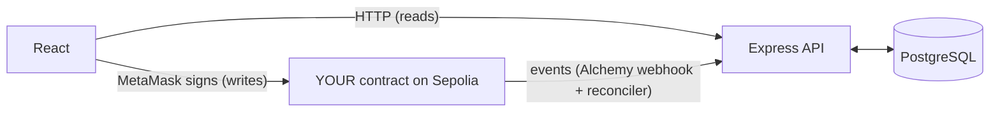

# 🏗️ Assignment — Build Your Own Small DApp

**Course:** Blockchain — Dr. Noshina Tariq · FAST-NUCES Islamabad
**Set by:** Taha Naqvi (guest session) · **Team:** individual or pairs *(your instructor decides)* · **Time:** ~2 weeks
**Deadline & submission method:** announced by your instructor

> Build a **small but complete** decentralized app, end to end, **100 % TypeScript**:
>
> | Layer | Use |
> |---|---|
> | Smart contract | **Hardhat** → deployed on **Ethereum Sepolia** |
> | Backend | **Express** + **PostgreSQL**. It listens to your contract's events and serves an API |
> | Frontend | **React** (Vite). It reads from your backend; users sign transactions with **MetaMask** |
>
> The goal is **not** a big project. The goal is to understand how the three layers of a real DApp fit together.



---

## 1. How to work (read this first)

1. **Understand the starter.** Read [docs/05-how-it-works.md](docs/05-how-it-works.md) (follow one vote through the code), then run the
   **Voting DApp** in [`dapp/`](dapp) **locally** ([dapp/README.md §3A](dapp/README.md)). *This alone teaches you most of the assignment.*
2. **Build your idea step by step** with **[docs/04-build-your-dapp.md](docs/04-build-your-dapp.md)** (worked example: a Tip Jar), developing
   **locally** (free, instant, no faucet needed).
3. **Deploy to Sepolia at the end** ([dapp/README.md §3B](dapp/README.md)), set up the Alchemy webhook ([docs/03-alchemy.md](docs/03-alchemy.md)),
   record your demo.

The infrastructure is already done: env validation, webhook signature checks, the reconciler, security middleware, the wallet code.
**Your job is the contract, the data model, the API routes and the pages for your idea.** Unknown word → [docs/GLOSSARY.md](docs/GLOSSARY.md).

---

## 2. Pick ONE idea (or propose your own)

Each idea is deliberately small. Do the **core**; **stretch** is optional extra credit.
*Voting is not allowed — it's the example.* Your own idea is welcome: send your instructor a 3-line description first.

| # | Idea | Core (required) | Stretch (optional) |
|---|---|---|---|
| 1 | 📝 **Message Wall** | Post a short message (optionally with an ETH tip to the owner); owner withdraws tips | Likes; per-user profile page |
| 2 | 💸 **Tip Jar for Creators** | Creators register a name; fans tip them in ETH; creators withdraw | Leaderboard of top creators/fans |
| 3 | 🔎 **Campus Lost & Found** | Post a lost item with an ETH bounty; finder claims; owner approves → bounty paid | Cancel & refund after a deadline |
| 4 | 🎓 **Certificate Verifier** | Issuer stores a certificate's hash; anyone verifies a file; issuer can revoke | Upload a PDF in the UI → backend hashes it |
| 5 | 🎉 **Event RSVP & Check-in** | Organizer creates an event with capacity; students RSVP; organizer checks them in | Attendance stats per event |
| 6 | 🤝 **Mini Crowdfunding** | Campaign with goal & deadline; donate; creator claims if goal met, else donors refund | Progress bar + top donors |
| 7 | 📚 **Item Lending** | List an item; borrow by paying a deposit; owner confirms return → deposit refunded | Late-return penalty |
| 8 | ✅ **Task Bounties** | Post a task with an ETH reward; someone submits; poster approves → reward paid | Deadlines and refunds |

> Idea #2 is worked through in the guide. You may pick it, but then you must add **at least one stretch feature**.

---

## 3. Requirements (keep it small, make it work)

### Contract (`contracts/`)
- [ ] **One contract** with **at least 3 state-changing functions**.
- [ ] An **event** for every state change (your backend learns everything from events!) and **custom errors** for failures.
- [ ] Access control where it matters (e.g. only the owner/organizer/issuer can do X).
- [ ] If it handles ETH: update state **before** sending ETH (Checks → Effects → Interactions).
- [ ] **≥ 8 tests**, including **≥ 3 revert cases** (`npm run test -w contracts`).
- [ ] Deployed to **Sepolia** with Ignition.

### Backend (`backend/`)
- [ ] Express + TypeScript + PostgreSQL (Prisma), adapted from the starter.
- [ ] Your **events are indexed** into your own tables, through the **Alchemy webhook** plus the starter's reconciler.
  *Your network blocks ngrok/webhooks?* Reconciler-only indexing is accepted (−5 points). Explain it in your README.
- [ ] **≥ 3 API endpoints**, e.g. *list*, *detail*, and one *filter or stats* endpoint.

### Frontend (`frontend/`)
- [ ] React + TypeScript, adapted from the starter.
- [ ] Connect MetaMask (Sepolia); show data **from your backend**.
- [ ] **≥ 2 write actions** (transactions) with a status message (*confirm in wallet → pending → confirmed / failed*) and a readable error.

### Submit
- [ ] A **GitHub repository** (copy steps: [04-build-your-dapp.md §9](docs/04-build-your-dapp.md)) with a `README.md` following the template below.
- [ ] A **3–5 minute demo video**: tests passing → contract on Etherscan → using the app (a transaction appearing in the UI).
- [ ] **No secrets in Git.** `.env` files and keys must never be committed (`git status` before every commit!).

<details>
<summary><b>📄 README template for your submission (click to open)</b></summary>

```markdown
# <App name>
One paragraph: what problem it solves and who uses it.

## Team
Name (roll no) — Name (roll no)

## Architecture
Contract → events → backend (Express + PostgreSQL) → API → React. (A diagram helps!)

## Smart contract
- Sepolia address: 0x... (Etherscan link)
- Functions and who can call them; events; custom errors

## API
| Method & path | Returns |
|---|---|

## Run it locally
1. npm install
2. ... (exact commands, in order)

## Screenshots
(3–4 screenshots of the main pages, including a pending → final transaction)

## Demo video
<link>

## What I learned / what was hard
```
</details>

### The viva (5–10 minutes)
You'll be asked to: show your app working · explain one contract function and its event · find where your backend stores that event
(`decode.ts` → `project()`) · explain one test · answer "what happens if the same webhook arrives twice?" or "why does the user sign, not the
server?". **AI tools are fine — not understanding your own code is not.**

---

## 4. Grading (100 + bonus)

| Part | Points |
|---|---|
| Contract: correct logic, events, errors, access control | 15 |
| Contract tests (≥ 8, revert cases) | 10 |
| Backend: events indexed into the database, working API | 25 |
| Frontend: wallet, data from API, ≥ 2 working transactions with status | 25 |
| README + demo video | 15 |
| Code quality & clean Git history (no secrets!) | 10 |
| **Bonus (up to +10)** | a stretch feature +4 · contract verified on Etherscan +2 · frontend/backend deployed online +2 · CI green on GitHub +2 |

---

## 5. Suggested plan

| Days | Do |
|---|---|
| 1–2 | Read 05-how-it-works. Run the Voting DApp **locally** (3A). Pick your idea. Write functions + events on paper. |
| 3–5 | Contract + tests → deploy **locally** → `npm run export:local`. |
| 6–9 | Backend: Prisma models → decode & store your events → API endpoints (still local). |
| 10–12 | Frontend: pages, data from the API, transactions. |
| 13–14 | Deploy to **Sepolia**, Alchemy webhook, README, screenshots, demo video. Ask a classmate to run your repo from the README. |

---

## 6. FAQ
**Do I need Docker?** No. Use a free **Neon** PostgreSQL database (copy its URL into `DATABASE_URL`). Docker is just the easiest local option.
**Can I use JavaScript instead of TypeScript?** No. TypeScript catches most mistakes before you run anything.
**Can I use wagmi/viem, Tailwind, or another UI library?** Yes, as long as it's React + Vite + TypeScript.
**Can I use Next.js / another backend?** No. React (Vite) + Express, so everyone learns the same architecture.
**I ran out of SepoliaETH.** Develop locally (free) and deploy to Sepolia once at the end. The Google faucet gives 0.05/day.
**My webhook doesn't fire.** Is ngrok running and the URL in Alchemy current? Check http://localhost:4040. The reconciler still indexes everything, just slower.
**Can the backend send transactions?** Only if your idea truly needs a server role (e.g. an issuer), with its key in `.env`, never users' keys.
**I changed my contract and things broke.** See "Common mistakes" in [04-build-your-dapp.md](docs/04-build-your-dapp.md).

## 7. Getting help
1. Read the **Troubleshooting** sections in [dapp/README.md](dapp/README.md) and [docs/01-setup.md](docs/01-setup.md), and [docs/GLOSSARY.md](docs/GLOSSARY.md).
2. Search the error message. Most are common.
3. Still stuck? Open an issue on this repository (*Issues → New issue → Question*), or contact me:

| | |
|---|---|
| 👤 **Taha Naqvi** | Full-stack Blockchain Engineer |
| GitHub | https://github.com/TahaNaqv |
| LinkedIn | https://www.linkedin.com/in/taha-a-naqvi/ |
| Email | t.a.naqvi14@gmail.com |

When you ask, include what you ran, the full error, and what you already tried. Good luck, and have fun building! 🚀
