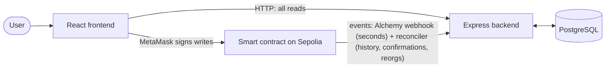

# ⛓️ Blockchain DApp Lab — Hardhat · Express · React (all TypeScript)

Hands-on material from the **guest session in Dr. Noshina Tariq's Blockchain course at FAST-NUCES Islamabad**,
plus a **complete full-stack DApp starter** for your assignment.

Everything here uses the tools blockchain teams use in industry, **100 % TypeScript**, on Ethereum's public **Sepolia** testnet:

| Layer | Tools |
|---|---|
| 📜 Smart contracts | **Hardhat 3** · Solidity · OpenZeppelin · Ignition |
| 🖥️ Backend | **Express** · **PostgreSQL** (Prisma) · **Alchemy** RPC + webhooks |
| 🎨 Frontend | **React** · Vite · ethers · **MetaMask** |

---

## 🗺️ What's inside

```
blockchain-dapp-lab/
├── docs/
│   ├── 01-setup.md               ← START HERE: install Node.js, VS Code, MetaMask, get free test ETH
│   ├── 02-session-lab.md         ← the guest-session labs, step by step
│   ├── 03-alchemy.md             ← free Alchemy account, RPC URL, webhooks, ngrok
│   ├── 04-build-your-dapp.md     ← turn the starter into YOUR DApp (worked example: Tip Jar)
│   ├── 05-how-it-works.md        ← follow one vote through the code (read before the assignment)
│   ├── GLOSSARY.md               ← every term in plain English
│   └── lab-answers.md            ← answers to the session questions (try first!)
│
├── session/                      ← 🧪 GUEST SESSION ACTIVITY (Hardhat only)
│   ├── playground/               ←   blockchain_playground.html: hash, mine, tamper (offline, in the browser)
│   └── hardhat-lab/              ←   contracts, tests and scripts for Labs 1–6
│
├── dapp/                         ← 🏗️ ASSIGNMENT STARTER: a complete Voting DApp (npm-workspaces monorepo)
│   ├── contracts/                ←   Hardhat: Voting.sol, tests, deployment, helper scripts
│   ├── backend/                  ←   Express + PostgreSQL: Alchemy webhook listener, indexer, REST API
│   └── frontend/                 ←   React: pages, wallet, transactions, data from the API
│
└── ASSIGNMENT.md                 ← 📝 your take-home: build a small DApp of your own
```

---

## 🚀 Learning path

| Step | What | Where |
|---|---|---|
| 1 | Set up your laptop (≈ 30 min, at home) | [docs/01-setup.md](docs/01-setup.md) |
| 2 | Do the session labs: hashing → first contract on Sepolia → testing → your own token → a hack & its fix → class vote | [docs/02-session-lab.md](docs/02-session-lab.md) |
| 3 | Understand how a full DApp works: follow one vote through the code | [docs/05-how-it-works.md](docs/05-how-it-works.md) |
| 4 | Run the full Voting DApp, locally first | [dapp/README.md](dapp/README.md) |
| 5 | Create a free Alchemy account (RPC + webhooks) for Sepolia | [docs/03-alchemy.md](docs/03-alchemy.md) |
| 6 | Build your own small DApp | [ASSIGNMENT.md](ASSIGNMENT.md) + [docs/04-build-your-dapp.md](docs/04-build-your-dapp.md) |

Stuck on a word? → [docs/GLOSSARY.md](docs/GLOSSARY.md). You need **Node.js LTS, Git, VS Code and MetaMask**. All covered in step 1.

### Quick start — session labs
```bash
git clone https://github.com/TahaNaqv/blockchain-dapp-lab.git
cd blockchain-dapp-lab/session/hardhat-lab
npm install
npx hardhat test          # ✅ 14 passing
```

### Quick start — full-stack DApp
```bash
cd ../../dapp             # from session/hardhat-lab  (or: cd blockchain-dapp-lab/dapp from where you cloned)
npm install
npm run test -w contracts # ✅ 18 passing
# then follow dapp/README.md §3A: local chain → database → backend → frontend
```

---

## 🧱 How a real DApp fits together (what you'll build)


- **Reads:** React → your API → your database (fast, searchable, paginated).
- **Writes:** the *user's* wallet signs the transaction → the contract emits an **event** → your backend hears it and stores it.
- **The blockchain is the source of truth;** the database is an index you can always rebuild from events.

---

## 🛟 Need help?

1. Check the **Troubleshooting** sections in [docs/01-setup.md](docs/01-setup.md) and [dapp/README.md](dapp/README.md).
2. Open an issue: **Issues → New issue → Question** (include the command, the full error, and what you tried).
3. Reach out to me. **LinkedIn is the fastest way:**

<table>
  <tr><td><b>👤 Taha Naqvi</b></td><td>Full-stack Blockchain Engineer</td></tr>
  <tr><td>GitHub</td><td><a href="https://github.com/TahaNaqv">github.com/TahaNaqv</a></td></tr>
  <tr><td><b>LinkedIn (preferred)</b></td><td><a href="https://www.linkedin.com/in/taha-a-naqvi/">linkedin.com/in/taha-a-naqvi</a></td></tr>
  <tr><td>Email</td><td><a href="mailto:t.a.naqvi14@gmail.com">t.a.naqvi14@gmail.com</a></td></tr>
</table>

> 🔐 **Never share** private keys, seed phrases, API keys or `.env` files: not in issues, not in chats, not in Git.
> Use a **practice wallet** with test ETH only.

---

## 🙏 Acknowledgements
Prepared for the BS Blockchain course of **Dr. Noshina Tariq**, Department of AI & Data Science, **FAST-NUCES Islamabad**.

## 📄 License
[MIT](LICENSE): use it, fork it, learn from it.
