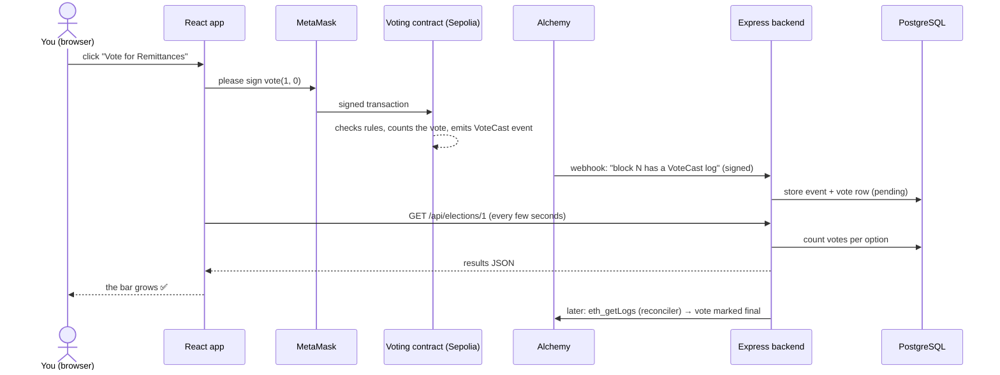

# 🔍 How the DApp Works: Follow One Vote Through the Code

Ten minutes with this page and the `dapp/` folder will make sense. We follow **one vote**, from the click to the screen, and open the
exact file at every step. Keep VS Code open next to this page. Unknown word? → [GLOSSARY.md](GLOSSARY.md).



---

## Step 1: The click (frontend)
📄 `frontend/src/pages/ElectionPage.tsx`
```ts
const vote = (option: number) =>
  tx.run(async () => appContract(await getSigner()).getFunction("vote")(id, option));
```
- `getSigner()` (from `wallet/WalletProvider.tsx`) asks **MetaMask** for the connected account.
- `appContract(...)` (from `lib/contract.ts`) builds an ethers `Contract` from the **ABI + address** that `npm run export` copied in.
- `tx.run(...)` (from `hooks/useTransaction.ts`) drives the status you see: *Confirm in your wallet… → Waiting for the next block… → ✔ Confirmed*.
  If something fails, `explainError()` turns e.g. `AlreadyVoted` into *"You have already voted in this election."*

> 🧠 **The frontend never holds a private key.** MetaMask shows the user what they're signing, and *they* approve it.

## Step 2: The contract decides (blockchain)
📄 `contracts/contracts/Voting.sol` → `function vote(uint256 electionId, uint8 option)`
1. **Checks:** not paused, election exists, not cancelled, voting window open, option valid, voter eligible, hasn't voted.
   Any failure → `revert` with a custom error → **nothing changes** and the frontend shows the friendly message.
2. **Effects:** `hasVoted[...] = true`, vote count `+1`.
3. **Event:** `emit VoteCast(electionId, msg.sender, option)` — a log written into the block. **This is how the outside world finds out.**

Thousands of nodes run this same code and must agree on the result. That's why it costs gas and waits ~12 s for a block.

## Step 3: Alchemy notices the event and calls our backend (the listener)
You created an Alchemy **Custom Webhook** with the query printed by `npm run webhook:query`: *"tell me about logs from this contract
with these event signatures"*. When a new block contains our `VoteCast` log, Alchemy sends an HTTP `POST` to `/webhooks/alchemy`.

📄 `backend/src/webhooks/alchemy.ts`
1. `isValidAlchemySignature()`: is this really from Alchemy? (an HMAC signature, otherwise `401`)
2. `payloadSchema.parse(...)`: does the JSON have the shape we expect? (otherwise `400`)
3. `db.webhookDelivery.create(...)`: have we seen this delivery id before? (Alchemy retries, so duplicates are ignored)
4. For each log: `decodeLog()` → `ingest()`.

## Step 4: Decode and store (indexer)
📄 `backend/src/indexer/decode.ts` → `decodeLog()` turns raw hex (`topics`, `data`) into a typed object:
`{ name: "VoteCast", args: { electionId: 1, voter: "0xab…", option: 0 } }`.

📄 `backend/src/indexer/ingest.ts` → `ingest()`
- saves the raw event in `ChainEvent` (id = `txHash:logIndex`, so saving it twice is harmless), marked **pending** (`confirmed: false`);
- calls `project()`, which updates the app's tables: for `VoteCast` it upserts a row in `Vote`.

📄 `backend/prisma/schema.prisma` shows those tables. `Vote.id` points to its `ChainEvent` with `onDelete: Cascade`. Remember that for step 7.

## Step 5: The frontend asks the backend (read path)
📄 `frontend/src/hooks/queries.ts` → `useElection(id)` calls `GET /api/elections/1` every 5 s while the election is active.
📄 `backend/src/api/elections.ts` → the route counts votes per option with a SQL `GROUP BY` and returns JSON, including `pendingVotes`.
📄 `ElectionPage.tsx` renders the bars and the votes table ("⏳ pending").

> 🧠 **Why not read the chain directly from React?** For one number you could. But lists, history, search, pagination and statistics are
> slow or impossible on-chain. A database answers them in milliseconds. That's what every real DApp does (Etherscan, OpenSea, Uniswap's UI).

## Step 6: The reconciler confirms it (correctness)
📄 `backend/src/indexer/reconciler.ts` → `tick()` runs every few seconds:
1. reads the chain head and goes `CONFIRMATIONS` blocks behind it (blocks that deep won't change);
2. fetches **all** logs of our contract in that range with `eth_getLogs` (10 blocks per request on Alchemy's free plan);
3. ingests them again. Same ids, so nothing is duplicated, but now each is marked **confirmed** → the UI shows "✔ final".

It also **fills gaps**: if the backend was down, or a webhook never arrived, the reconciler still finds every event since the deploy block.
So the app works even without a webhook, just slower.

## Step 7: When the chain changes its mind (reorg)
Very rarely, the network replaces a recent block (a **reorg**). If our webhook had told us about a vote in the dropped block, that
vote never really happened. The reconciler notices that event is missing from the confirmed range and **deletes it**. Because of
`onDelete: Cascade`, the `Vote` row disappears too, and the counts fix themselves.

> 🧠 *Webhooks are for speed, the reconciler is for truth.* The database is a fast **index** of the chain. You can delete it and the
> reconciler rebuilds everything from the deploy block.

---

## What you'll write for your own DApp
For the assignment you **keep steps 3, 6 and 7 as they are** (they already work for any contract). You write:
- **Step 2:** your contract and its events;
- **Step 4:** how to decode your events (`decode.ts`) and which rows they create (`project()` in `ingest.ts`, plus `schema.prisma`);
- **Step 5:** your API routes and React pages;
- **Step 1:** your buttons, using the same `useTransaction` pattern.

➡️ Step-by-step: [04-build-your-dapp.md](04-build-your-dapp.md)

## Learn the building blocks (if they're new to you)
| Topic | Good starting point |
|---|---|
| TypeScript | https://www.typescriptlang.org/docs/handbook/typescript-in-5-minutes.html |
| Express | https://expressjs.com/en/starter/hello-world.html |
| Prisma + PostgreSQL | https://www.prisma.io/docs/getting-started |
| React | https://react.dev/learn/thinking-in-react |
| TanStack Query | https://tanstack.com/query/latest/docs/framework/react/overview |
| ethers v6 | https://docs.ethers.org/v6/getting-started/ |
